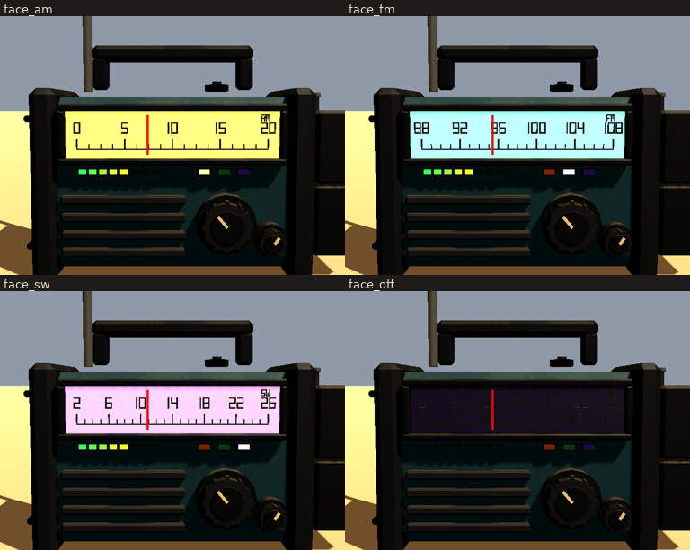
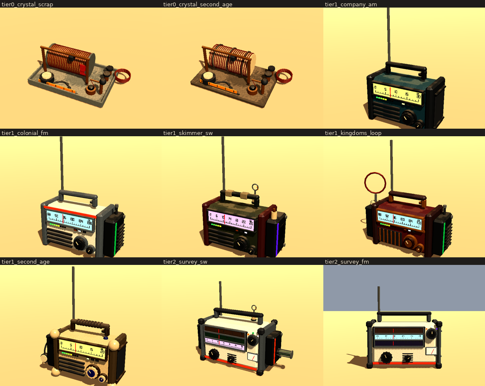
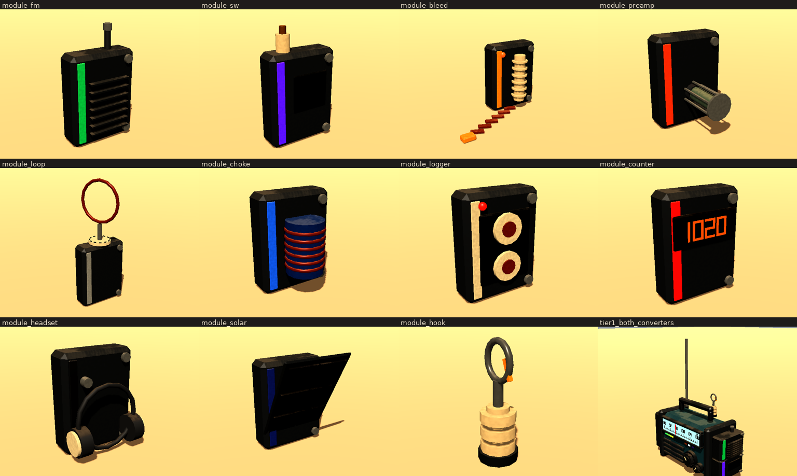
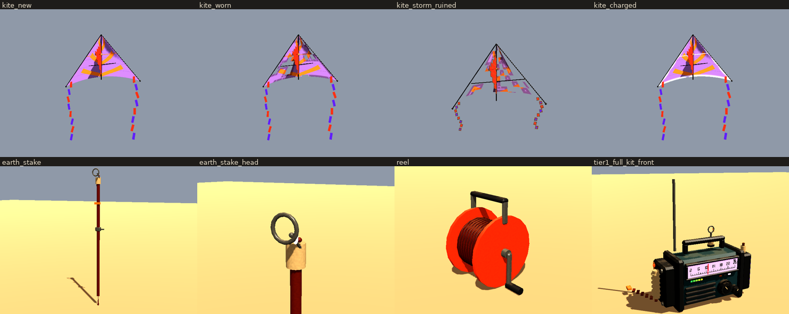
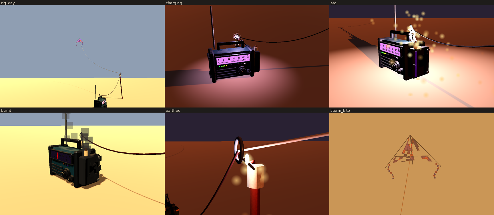

# Radio equipment: tiers, upgrades, shortwave

*A design proposal and a modelling lab, 2026-10-21. Nothing here is in the
game yet. The models use the game's own kit (`Paint.Pieces` and the worn
shader). If they're agreed, they move into `game/look/dress.gd` and the
catalog more or less as they are. Sheets are in `out/`.*

What was asked for (gonkhub): three tiers of radio and several visual styles,
upgrades, and exterior gear. Each band (AM, FM, shortwave) gets its own
colour so you can see which one you're scrubbing. Specifically:

- a crystal set;
- the current radio, with slots;
- shortwave through a converter, a hook and an antenna kite, with
  electrostatic burnouts unless you use an earth stake or a bleed resistor;
- a kite that wears like the sails and is ruined fast in a sandstorm;
- several modular upgrades.

The design follows below.

## Bands and their colours

`bands.gd`. The band window glows in its band's colour, and the needle's
scale is numbered for that band. The band's name sits in the window's
corner. Three small tells under the window show AM, FM and SW: lit for the
band it's on, dim for one it can reach, capped black where no converter is
fitted. A converter's tell stripe is its band's colour too.

| Band | Colour | Range | Scale | What it's for |
|---|---|---|---|---|
| **AM** | Amber (today's window) | 0–2000 kHz | 0 5 10 15 20 (×100 kHz) | Everything the game has now: the gods, music, beacon, satellites |
| **FM** | Sea green | 88–108 MHz | 88 … 108 | Short reach, line of sight, no sky wave, but clean: storm static barely touches it (it's frequency, not amplitude). Camp-to-camp, the city's scouts close in, a beacon you're nearly on |
| **SW** | Violet | 2–26 MHz | 2 … 26 | Bounces off the sky: far, faint, fading voices. Only really heard from a kite flown high. The Surveyor's schedule, distant stations, Varran "above the storms" |



## Tiers



| Tier | Set | Power | Slots | Hears |
|---|---|---|---|---|
| 0 | **Crystal set**: a coil wound on a food can with a slider down it to tune; a crystal in a cup touched by a cat's whisker; an earpiece on a cord; brass posts for an aerial and an earth. Held in one hand. Scrap (tin tray, can, bell wire) or second-age (saltwood board, ceramic former, cord) | None | None | Weak AM only: strong near carriers (the beacon, a god close by), nothing far. Its band strip is a scrap of amber paint on the tray |
| 1 | **Field radio**: the one the game carries, its sockets made real | Battery or pool, 2 W | Converter bay (right cheek), battery (back), hook boss (top), misc bay (left cheek) | AM; FM or SW by converter |
| 2 | **Survey set**: a colonial three-band receiver. A wide slide-rule dial with a scale per band (the one it's on lit), a band selector with a detent in each band's colour, a signal meter, bumper corners | Battery or pool, 3 W | Two bays, hook boss | AM and FM built in; SW by converter |

**Makers' looks for the field radio** (`STYLES`), following the
art direction's shape by era:

- **Company issue:** teal and gunmetal, as today.
- **Colonial survey:** off-white, grey, an orange band.
- **Skimmer crew:** olive, a red plate riveted over a crack, tape on the
  handle.
- **First Kingdoms:** red enamel, a brass waist band, a fretwork grille,
  hardwood knobs and handle.
- **Second age:** ceramic, its lost corners recast in salt glaze, a
  cord-wound saltwood handle, a blue-glazed charm.

The look doesn't change what a set does; it changes what it says about
where it's been.

## Slots and modules



The field radio's sockets (gonkhub, 2026-10-21: "a slot for both"):

- **Converter bay** (right cheek): a slot for each converter, FM and SW, so
  one set can hear all three bands.
- **Misc bay** (left cheek): any one other module.
- **Battery** (back): the game's battery, as now.
- **Hook boss** (top): the kite's hook.

A module is a cartridge with a tell stripe in its colour and two thumb
screws. It slides in and out of a bay the way a part goes into a socket
today (`Device.fit`).

The trade-off is now the misc bay alone. SW needs earthing: the stake
outside, or the bleed resistor, which takes the misc bay. So a set that
bleeds gives up the preamp, the loop, the logger and the rest. The converter
bay is drawn as two half-height slots, FM over SW (`"converters"`; the last
tile of the modules sheet).

| Module | Bay | Does | Costs |
|---|---|---|---|
| **FM converter** (sea green, fins, a coax stub) | Converter | Hears FM | +0.5 W |
| **Shortwave converter** (violet, a windowed toroid, a ceramic aerial port) | Converter | Hears SW; takes the kite's lead at its port | +0.5 W; the piece most often burnt out |
| **Bleed resistor** (yellow, a finned ceramic resistor, a neon that flickers as it bleeds, a copper earth strap with a clip) | Misc | Leaks the aerial's charge off steadily. Enough in fair weather and a breeze; overwhelmed by a dust front | The misc bay |
| **Valve preamp** (orange, a glowing valve in a cage) | Misc | Lifts weak signals out of the hiss (+6 dB) | ×3 power |
| **Direction loop** (steel, a copper loop on a bearing ring) | Misc | Turn it for the null: the carrier's bearing. Finds a god, or a Walker | Turning it by hand |
| **Static choke** (blue, a wound can) | Misc | Takes the edge off storm hash (static −50%), and a little signal (−2 dB) | — |
| **Wire logger** (bone, two reels, a red record lamp) | Misc | Records what it's tuned to and plays it back: a report you half heard | — |
| **Frequency counter** (red digits) | Misc | Reads the exact frequency: no hunting for a carrier by ear | +0.3 W |
| **Headset jack** (black, the headset on its cord) | Misc | Listen close: wind and storm noise don't drown it, and nothing else hears it | — |
| **Solar lid** (blue cells, hinged open) | Misc | Trickles a charge into its battery by day | — |
| **Kite hook** (top boss) | Hook | A steel eye with a snap gate on a stack of ceramic insulators | — |

## Shortwave: the kite rig and static



**The rig:**

1. Fit a SW converter and the hook.
2. Run the aerial lead (copper on a hand reel, its clip to the converter's
   port) up to the hook.
3. Fly the antenna kite on its line. The line is braided with a conductor
   and clipped to the lead at the hook.
4. To earth it, run the line through the earth stake's ring first. The
   stake is a copper rod with a clamp, an insulated ring for the line and a
   spark gap from ring to rod. Or fit the bleed resistor and clip its strap
   to anything in the sand.

**The kite:**

- A delta, 1.4 m across, shortwave violet with survey-orange chevrons and a
  copper dipole sewn across its shoulder, on a carbon spine.
- It has a keel with the towing ring at its tip, and two tails.
- Its sail is a cloth shader (`kite.gdshader`) that tears the way the game's
  sail does: cells go, the edges first, with frayed rims round each hole.
  Charged, the dipole and the edges glow with a flickering violet corona.

**Height is signal.** The line's angle rises with the wind: the kite won't
fly below 3 m/s, flies best at 6–12 m/s, and is pressed back past that. On
120 m of line it stands 60–88 m up. That gives SW about 23–25 dB over the
whip, roughly 10 dB per tenfold of height, with a ceiling. More line means
more signal, and more charge.

**Static.** The kite gathers charge in proportion to its height. The dust a
front's outflow drives charges it fifteen times faster: the same thing that
already raises a radio's static (`WeatherField.outflow_at`). Charge leaks
off on its own, slowly, so it climbs toward a balance and a long flight's
risk escalates.

- Past a threshold, an arc can jump somewhere in the rig. Its chance per
  second rises with the square of how far past the threshold the charge
  is.
- An arc picks a piece by exposure: the kite's dipole, the lead, the hook,
  the SW converter or the radio. Most arcs burn that piece out; the rest
  scorch it.
- The stake's spark gap dumps anything over its own threshold to earth.
- The bleed resistor leaks steadily, with a 20 s time constant.

`charge_model.gd` (the full table is in `charge_model.txt`) gives, for 20
minutes on 120 m of line:

| Weather | Unearthed | Bleed resistor | Earth stake | Kite left (staked) |
|---|---|---|---|---|
| Calm, 4 m/s | 28% chance of a burnout, the first at ~16 min | Safe | Safe | 94% |
| Breezy, 9 m/s | Certain, at ~3 min | Safe | Safe | 94% |
| Dust front, 13 m/s | Certain, at ~30 s | Burnout at ~1 min | Safe | 14% |
| Sandstorm, 22 m/s | Usually (the kite often goes first) | 66% | Safe | Ruined in ~75 s |

So on a still day an unearthed kite is a gamble that gets worse the longer
you fly. In a breeze it costs you something within minutes. Ahead of a
storm only the stake holds, and in the storm itself the kite is gone in
about a minute. Normal flying wears the kite very little (about 4% over 20
minutes, plus a little from winds past 14 m/s).

**Effects** (`rig.gd`):

- **Charging:** a corona of violet sparks at the hook and the stake's ring,
  and the kite's dipole glows. The radio's static rises; `ARC_LOOP`
  crackles.
- **Arc:** a jagged white-violet bolt down the lead into the converter and
  across to the case, a flash of violet light, and a burst of sparks
  (`ScrapFx`), with `ZAP`.
- **Burnt out:**
  - The piece goes charred, its stripe scorched brown, soot blown back
    over the case, and smoke curls off it for a while.
  - A burnt converter takes its band's tell dark; a burnt radio is
    `wrecked()`.
  - A burnt dipole shows as a scorched kite that hears nothing.
- **Earthed:** the same charge leaps the stake's spark gap instead, a small
  bright crack with a few sparks. This is the reassuring version.
- **Kite in a sandstorm:** half its sail gone, its tails torn short.



## The Surveyor's schedule on shortwave

(gonkhub, 2026-10-21: "the surveyor flyer's shortwave broadcast needs to
inform the player of when its flyover will occur.") Frontier Ag's crop survey
announces its next pass over where you are, in the bundled voice
(`RadioSpeech`, whose word bank already has *surveyor, due, in, minutes,
bearing, elevation, degrees, signal flare*). For example: "Surveyor. Due in
twelve minutes, from the north east, elevation seventy degrees." Once it's
high enough to fire: "Surveyor overhead. Signal flare." Until the SW band
exists, it's read on the survey's own AM carrier (320–350 kHz). Once SW
exists, the carrier moves there, so a kite rig is how you hear the schedule
from afar. That's a reason to fly one.

## Open questions

1. *(Settled 2026-10-21: a slot for each converter.)*
2. **FM content:** what's on FM? Camp-to-camp, scouts, a lost colony
   station?
3. **Repair:** burnt pieces are wrecked like any device ("nothing mends
   yet"). Should a scorched (not burnt) piece just lose some soundness?
4. **The crystal set's earpiece:** heard only by you, at hand. Should it
   still play into the world quietly?
5. **Survey set:** a find (colonial deep layer), or kit for some origin?

## Into the game

1. Catalog: `crystal_set` and `survey_set` as devices (the radio flag; a
   `bands` stat). Modules as parts of a new socket kind `&"radio_bay"`,
   whose stats say what they add. `kite_hook` as a `&"radio_top"` part.
   `antenna_kite` as a device on a `Line`. `earth_stake` as a Stake with a
   `guide`, so `Line.route` runs through it.
2. `Dial`: a `band` and per-band ranges. Carriers get a band. `Dial.strength`
   gets FM (line of sight, no sky wave) and SW (sky wave, plus kite gain).
3. Static: a `Charge` on the rig (`charge_model.gd`'s numbers moved to
   `tuning.tres`); burnouts through `Device.wear(INF)`; effects as in
   `rig.gd`.
4. Kite wear on its own `durability`, driven like the sail's (`wear.gd`'s
   storm rate, the wind past harm).
5. Probes, one each:
   - the band window takes its band's colour;
   - an unearthed kite burns something in a breeze;
   - the stake keeps it safe;
   - a sandstorm ruins the kite;
   - the Surveyor reads its schedule.
6. Deeds where it happens, for example "Grounded" (a first arc taken by the
   stake) and "Sky Wave" (a first shortwave voice heard).

## Look-tests

```
scripts/unseen.sh --path . --resolution 640x480 res://look/radio_kit/studio.tscn -- <out dir> [filter]
scripts/unseen.sh --path . --resolution 960x600 res://look/radio_kit/rig.tscn -- <out dir> [filter]
godot --headless --script res://look/radio_kit/charge_model.gd
```

The studio shoots each tier, style, band face, module and piece of
shortwave gear. The rig shoots the shortwave setup by day, then charging,
the arc, the burnt-out converter, the stake taking the arc, and the kite in
a sandstorm. The `out/` sheets were rendered in software GL (llvmpipe, no
glow). On a GPU the windows and the arc glow.
